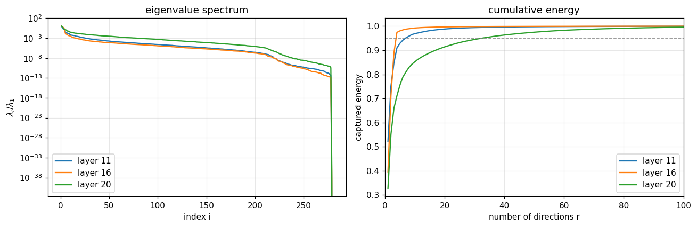
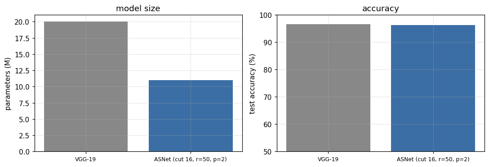
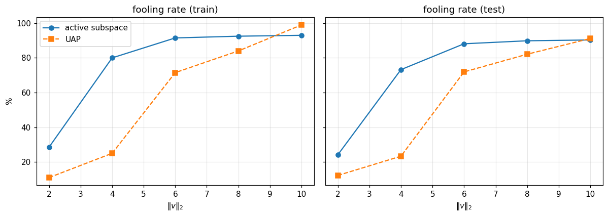
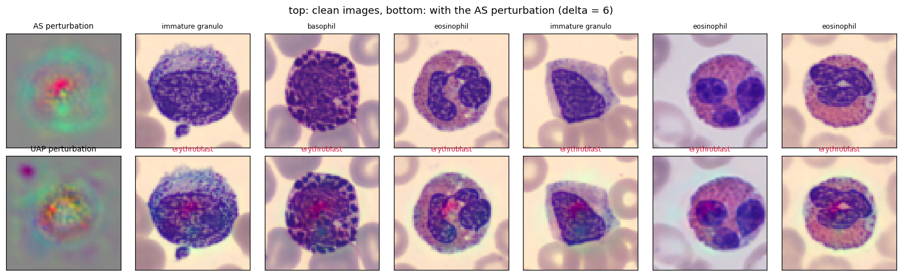

# Active Subspace of Neural Networks on BloodMNIST

[](https://github.com/fatemehsalmani75/active-subspace-bloodmnist/actions/workflows/tests.yml)
[](LICENSE)


<a href="https://colab.research.google.com/github/fatemehsalmani75/active-subspace-bloodmnist/blob/main/notebooks/bloodmnist_active_subspace.ipynb"></a>

PyTorch code for my MSc thesis *Structural Analysis of Deep Neural Networks* (Shahid Beheshti University,
supervisor Dr. Masoud Hajarian).

It is a **from-scratch re-implementation** of *Active Subspace of Neural Networks* (Cui et al., SIMODS 2020),
applied to a medical imaging dataset the paper did not use (BloodMNIST, 8 classes of blood-cell microscopy images),
and extended with my own experiments on **why** the active-subspace attack works and whether the same idea can
**defend** a model.

## Highlights

- **Compression (ASNet):** 1.82x fewer parameters for VGG-19 at a cost of 0.2 points of test accuracy (96.5% → 96.3%).
- **Universal attack:** at ‖v‖₂ = 4 the active-subspace (AS) perturbation fools **51 ± 3%** of test images versus
  **24 ± 9%** for UAP — about 2x, with a much smaller spread.
- **Why it works:** 39% of the AS perturbation's energy lies in just 5 of 12 288 input directions (UAP: 12%);
  it pushes images towards cells with a round, compact nucleus.
- **Defense:** fine-tuning on AS perturbations cuts AS fooling from 66% to 19% and UAP fooling from 33% to 8%, but it
  does not beat Universal Adversarial Training or PGD adversarial training. Purification and detection along the
  active subspace fail under adaptive attacks.
- **Pre-registered hypothesis test:** the top eigenvalue of the input-gradient covariance does **not** determine
  universal vulnerability — rejected in Phase 2 with a matched-accuracy control.

## Method

Cut a trained network after some layer and look at the gradients of the loss with respect to the neurons of that
layer. Their covariance matrix usually has only a few large eigenvalues, so a small number of directions (the
*active subspace*) explains most of what the rest of the network does. This is used for two things:

- **compression (ASNet):** keep the first layers, project onto the active subspace and replace the rest of the
  network with a polynomial chaos expansion;
- **universal attacks:** build one perturbation for all images from the dominant active direction of the input
  gradients, and compare it with the UAP attack of Moosavi-Dezfooli et al. (2017).

## Results: reproducing the paper on BloodMNIST

VGG-19 trained for 20 epochs on 64x64 BloodMNIST (Colab, T4 GPU). Full run:
[`bloodmnist_active_subspace.ipynb`](notebooks/bloodmnist_active_subspace.ipynb).

### Active subspace



The gradient covariance is strongly low-rank. After layer 16 (4th pooling) a handful of directions already capture
95% of the energy, out of 8192 neurons. Deeper in the network (layer 20) the energy is more spread out.

### ASNet

| model | test accuracy | parameters | compression |
|---|---|---|---|
| VGG-19 | 96.52% | 20.04 M | 1.00x |
| ASNet (cut 16, r = 50, p = 2), least-squares init only | 96.23% | 11.01 M | 1.82x |
| ASNet (cut 16, r = 50, p = 2), after 10 epochs fine-tuning | 96.29% | 11.01 M | 1.82x |



Replacing the last four 512-channel conv layers and the classifier (about 9.4 M parameters) with the AS + PCE
layers (about 0.4 M) costs only 0.2 points of accuracy, and the least-squares initialization alone is almost as good
as fine-tuning. Most remaining parameters are in the first 16 layers, so cutting earlier (e.g. after layer 11)
should give a larger compression; this was not tested here.

### Universal attacks

Fooling rate on the **test set**, perturbation built from 200 training images (single run):

| ‖v‖₂ | 2 | 4 | 6 | 8 | 10 |
|---|---|---|---|---|---|
| active subspace | **24.1%** | **73.2%** | **88.1%** | **89.9%** | 90.3% |
| UAP | 12.2% | 23.3% | 71.9% | 82.1% | **91.2%** |



Repeated with 3 different sets of 200 training images on a newly trained VGG-19 (97.3% test accuracy), mean ± std:

| ‖v‖₂ | active subspace | UAP |
|---|---|---|
| 4 | **51.0 ± 2.6%** | 23.9 ± 8.5% |
| 6 | **77.9 ± 5.3%** | 60.0 ± 4.3% |

The absolute numbers depend on the trained model (73% vs 51% at ‖v‖₂ = 4 for two trainings), but the gap is stable:
about 2x at ‖v‖₂ = 4, with a much smaller spread for the AS attack.



The AS perturbation is concentrated in the center of the image, where the cell is.

## Beyond the paper

| question | short answer | details |
|---|---|---|
| Why is the AS attack stronger, and where do fooled images go? | It concentrates its budget on the few input directions the model is most sensitive to, and adds what the model reads as a round, compact nucleus (lymphocyte / erythroblast). | [docs/defense.md §1–2](docs/defense.md#1-the-as-perturbation-lives-in-a-few-input-directions) |
| Can we project the active subspace out of the input, or detect the attack along it? | No: an adaptive attack still fools 28–49%, clean accuracy drops, and detection AUC stays ≤ 0.66. | [docs/defense.md §3–4](docs/defense.md#3-purification-does-not-survive-an-adaptive-attack) |
| Does adversarial fine-tuning with AS perturbations help? | Yes (AS fooling 66% → 19%), and it transfers to UAP. It matches UAT, but PGD-AT is stronger. | [docs/defense.md §5–6](docs/defense.md#5-adversarial-fine-tuning-with-the-as-attack-works) |
| Does the top eigenvalue $\lambda_1$ predict universal vulnerability? | Not beyond the overall gradient size; the pre-registered hypothesis is rejected. | [docs/spectrum.md](docs/spectrum.md) |

## Notebooks

All notebooks run on a free Colab T4 GPU and save checkpoints to Google Drive.

| notebook | content |
|---|---|
| [`bloodmnist_active_subspace`](notebooks/bloodmnist_active_subspace.ipynb) | training, spectrum, ASNet, AS vs UAP attack |
| [`defense_and_analysis`](notebooks/defense_and_analysis.ipynb) | input-space active subspace, attractor class, purification, detection |
| [`robust_training`](notebooks/robust_training.ipynb) | Mahalanobis detection, AS adversarial fine-tuning |
| [`defense_baselines`](notebooks/defense_baselines.ipynb) | UAT, UAP fine-tuning, PGD-AT, timing |
| [`phase1_spectrum_diagnostic`](notebooks/phase1_spectrum_diagnostic.ipynb) | $\lambda_1$ / tr C vs fooling across six models |
| [`phase2_spectral_regularization`](notebooks/phase2_spectral_regularization.ipynb) | $\lambda_1$ penalty vs trace penalty |

## Run it locally

```bash
pip install -r requirements.txt

python scripts/train.py --model vgg19 --size 64 --epochs 30
python scripts/compress.py --ckpt checkpoints/vgg19_s64.pt --cut 16 --r 50 --p 2
python scripts/compress.py --ckpt checkpoints/vgg19_s64.pt --cut 16 --r 50 --l1 1e-4   # sparse ASNet-s
python scripts/attack.py --ckpt checkpoints/vgg19_s64.pt --delta 2 4 6 8 10 --n-train 200
python scripts/attack.py --ckpt checkpoints/vgg19_s64.pt --target-class 3 --n-train 100

pytest -q   # small tests on random data, no download needed
```

BloodMNIST is downloaded automatically by the `medmnist` package.

## Code

```
asnet/
  data.py             BloodMNIST loaders
  models.py           VGG-19 and a small CNN, written so they can be cut after any layer
  active_subspace.py  gradient covariance, frequent-directions sketch, choice of r
  pce.py              Hermite polynomial chaos layer, least-squares fit
  asnet.py            ASNet, distillation fine-tuning, l1 proximal step
  attack.py           active-subspace universal attack
  defense.py          input-space active subspace, purification, detection
  robust.py           AS fine-tuning and the baselines (UAT, UAP fine-tuning, PGD-AT)
  analysis.py         checks for the attractor class
  spectrum.py         exact input-gradient spectrum (lambda_1, tr C)
  uap_baseline.py     UAP baseline (through the Adversarial Robustness Toolbox)
scripts/              train / compress / attack from the command line
notebooks/            Colab notebooks (table above)
results/              CSV tables of Phase 1 and Phase 2
docs/                 detailed write-ups of the extension experiments
tests/                smoke tests on random data
```

Implementation notes:

- 64x64 images are used because VGG-19 has five pooling layers and 28x28 images become too small.
- Defaults follow the paper where possible: p = 2, r = 50 (or chosen with eps = 0.05), distillation weight 0.1,
  Adam with learning rate 1e-4 for the first layers and 1e-5 for the new layers, alpha = 10 failed steps,
  200 images for the attacks and 10 iterations for UAP.
- Images are normalized to [-1, 1] and delta is the l2 norm of the perturbation in that space. The values in the
  paper were for CIFAR images, so a range of deltas is tried here.
- Fooling rate = fraction of images whose predicted label changes after adding the perturbation.
- The step-size search in the attack (signs ±1, steps delta, delta/2, ...) and the exact form of the
  distillation loss are my choices; the paper does not fix them completely.

## Thesis

F. Salmani. *Structural Analysis of Deep Neural Networks*. MSc thesis in Applied Mathematics (Numerical Analysis),
Shahid Beheshti University, 2024. Supervisor: Dr. Masoud Hajarian.

The numbers in the thesis were obtained with an earlier version of the code; this repository is a clean
re-implementation.

## References and credits

All code in this repository was written for this project; nothing was copied from the authors' original
repositories (they have no license).

- C. Cui, K. Zhang, T. Daulbaev, J. Gusak, I. Oseledets, Z. Zhang. Active Subspace of Neural Networks: Structural
  Analysis and Universal Attacks. *SIAM J. Math. Data Sci.* 2(4):1096–1122, 2020.
  [doi:10.1137/19M1296070](https://doi.org/10.1137/19M1296070), [arXiv:1910.13025](https://arxiv.org/abs/1910.13025).
  Original code: https://github.com/chunfengc/ASNet
- P. G. Constantine. *Active Subspaces*. SIAM, 2015.
- E. Liberty (KDD 2013); M. Ghashami, E. Liberty, J. M. Phillips, D. P. Woodruff (SIAM J. Comput. 2016).
  Frequent directions.
- S.-M. Moosavi-Dezfooli, A. Fawzi, O. Fawzi, P. Frossard. Universal Adversarial Perturbations. CVPR 2017.
  Original code: https://github.com/LTS4/universal. The baseline here uses the implementation in
  [Adversarial Robustness Toolbox](https://github.com/Trusted-AI/adversarial-robustness-toolbox) (MIT).
- G. Hinton, O. Vinyals, J. Dean. Distilling the Knowledge in a Neural Network, 2015.
- A. Shafahi, M. Najibi, Z. Xu, J. Dickerson, L. S. Davis, T. Goldstein. Universal Adversarial Training. AAAI 2020.
  The AS fine-tuning loop follows the same idea, with the AS attack generating the perturbation.
- **Data:** BloodMNIST from MedMNIST v2 (J. Yang et al., *Scientific Data* 10:41, 2023; ISBI 2021), CC BY 4.0,
  based on A. Acevedo et al., *Data in Brief* 30:105474, 2020. The images are not included in this repository.
  Not for clinical use.

BibTeX entries are in [`CITATION.bib`](CITATION.bib) and licenses of the dependencies in
[`THIRD_PARTY_NOTICES.md`](THIRD_PARTY_NOTICES.md).

## License

MIT, see [LICENSE](LICENSE).
