# Active Subspace of Neural Networks on BloodMNIST

<a href="https://colab.research.google.com/github/fatemehsalmani75/active-subspace-bloodmnist/blob/main/notebooks/bloodmnist_active_subspace.ipynb"></a>

PyTorch code for my MSc thesis *Structural Analysis of Deep Neural Networks* (Shahid Beheshti University,
supervisor Dr. Masoud Hajarian), rewritten from scratch for BloodMNIST.

The idea comes from Cui et al. (2020): cut a trained network after some layer and look at the gradients of the
loss with respect to the neurons of that layer. Their covariance matrix usually has only a few large eigenvalues,
so a small number of directions (the *active subspace*) explains most of what the rest of the network does.
This is used for two things:

- **compression (ASNet):** keep the first layers, project onto the active subspace and replace the rest of the
  network with a polynomial chaos expansion;
- **universal attacks:** build one perturbation for all images from the dominant active direction of the input
  gradients, and compare it with the UAP attack of Moosavi-Dezfooli et al. (2017).

The paper used CIFAR-10/100 and Fashion-MNIST. Here the same methods are applied to BloodMNIST
(8 classes of blood cell microscopy images).

## Results

VGG-19 trained for 20 epochs on 64x64 BloodMNIST (Colab, T4 GPU). Full run: [the notebook](notebooks/bloodmnist_active_subspace.ipynb).

### Active subspace

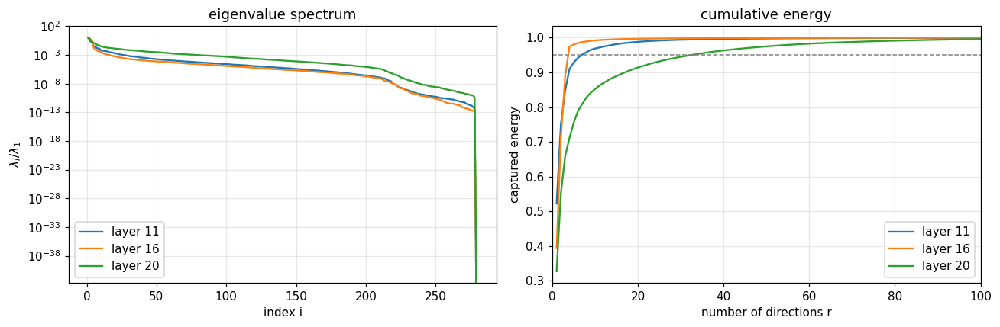

The gradient covariance is strongly low-rank. After layer 16 (4th pooling) a handful of directions already capture
95% of the energy, out of 8192 neurons. Deeper in the network (layer 20) the energy is more spread out.

### ASNet

| model | test accuracy | parameters | compression |
|---|---|---|---|
| VGG-19 | 96.52% | 20.04 M | 1.00x |
| ASNet (cut 16, r = 50, p = 2), least-squares init only | 96.23% | 11.01 M | 1.82x |
| ASNet (cut 16, r = 50, p = 2), after 10 epochs fine-tuning | 96.29% | 11.01 M | 1.82x |

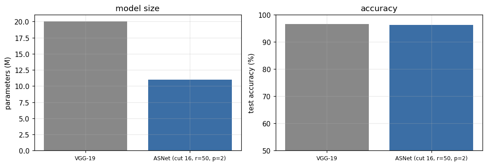

Replacing the last four 512-channel conv layers and the classifier (about 9.4 M parameters) with the AS + PCE
layers (about 0.4 M) costs only 0.2% accuracy, and the
least-squares initialization alone is almost as good as fine-tuning. Most remaining parameters are in the first 16
layers, so cutting earlier (e.g. layer 11) should give a larger compression; that is the next experiment.

### Universal attacks

Fooling rate on the **test set**, perturbation built from 200 training images:

| ‖v‖₂ | 2 | 4 | 6 | 8 | 10 |
|---|---|---|---|---|---|
| active subspace | **24.1%** | **73.2%** | **88.1%** | **89.9%** | 90.3% |
| UAP | 12.2% | 23.3% | 71.9% | 82.1% | **91.2%** |

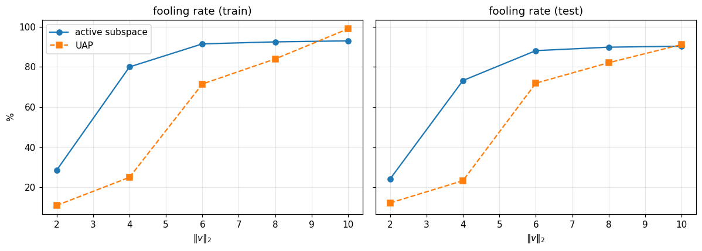

The table above is a single run. Repeated with 3 different sets of 200 training images (second notebook, a newly
trained VGG-19 with 97.3% test accuracy), mean ± std of the test fooling rate:

| ‖v‖₂ | active subspace | UAP |
|---|---|---|
| 4 | **51.0 ± 2.6%** | 23.9 ± 8.5% |
| 6 | **77.9 ± 5.3%** | 60.0 ± 4.3% |

The absolute numbers depend on the trained model (73% vs 51% at ‖v‖₂ = 4 for two trainings), but the gap is stable:
about 2x at ‖v‖₂ = 4, with a much smaller spread for the AS attack.

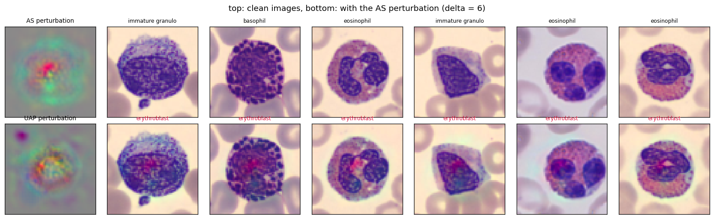

The AS perturbation is concentrated in the center of the image, where the cell is.

## Why the attack works, and can the same idea defend?

[`notebooks/defense_and_analysis.ipynb`](notebooks/defense_and_analysis.ipynb) <a href="https://colab.research.google.com/github/fatemehsalmani75/active-subspace-bloodmnist/blob/main/notebooks/defense_and_analysis.ipynb"></a>

Here the active subspace is computed in **input space**: the top-k eigenvectors $U_k$ of
$\mathbb{E}[\nabla_x \ell \, \nabla_x \ell^T]$ over 2000 clean training images.

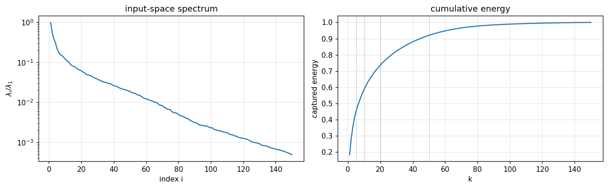

### The AS perturbation lives in a few input directions

Fraction of $\|v\|^2$ inside $\mathrm{span}(U_k)$ (‖v‖₂ = 4, mean ± std over 3 runs; the image has 12 288 dimensions):

| k | 5 | 10 | 20 | 50 |
|---|---|---|---|---|
| active subspace | **38.8 ± 9.0%** | **47.4 ± 10.2%** | **60.2 ± 12.3%** | **72.6 ± 5.0%** |
| UAP | 11.9 ± 2.6% | 22.9 ± 8.3% | 40.9 ± 13.5% | 53.3 ± 12.5% |

The AS attack concentrates its budget on the directions the model is most sensitive to, which explains why it is
stronger at the same norm.

### Where do fooled images go?

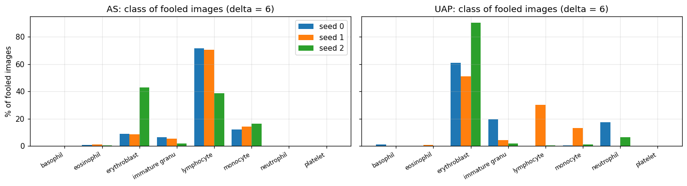
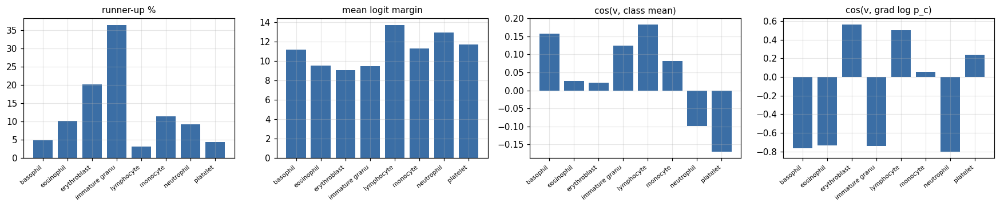

- The attractor class is **not fixed**: the AS attack sends most fooled images to *lymphocyte* (about 70% in two runs,
  *erythroblast* in the third), UAP mostly to *erythroblast*.
- It is **not the nearest class**: lymphocyte is the runner-up class of only 3% of clean images and has the
  largest mean logit margin of all classes.
- The perturbation does **not look like** the average image of any class (|cos| < 0.2), but it is aligned with the
  model's gradient of $\log p_c$ for erythroblast (0.56) and lymphocyte (0.50), and opposite to the four granulocyte
  classes (about −0.75).

Erythroblasts and lymphocytes are the two cell types with a single round, dense nucleus filling most of the cell;
basophils, eosinophils, neutrophils and immature granulocytes have lobed or granular nuclei. The perturbation sits on
the nucleus and adds what *the model* treats as evidence of a round compact nucleus.

### Purification does not survive an adaptive attack

Classify $x - U_kU_k^T(x-\mu)$ instead of $x$ (‖v‖₂ = 4):

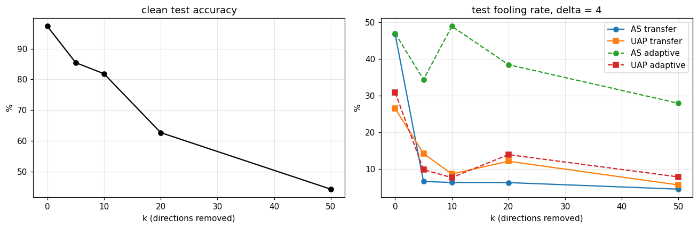

Removing 5 directions makes the original AS perturbation useless (47% → 7%), but an attack re-run on the defended
model still fools 28–49% of the images, and clean accuracy drops from 97% to 85% (k = 5) and 63% (k = 20). The input
spectrum decays slowly (50 directions for 92% of the energy), so these directions also carry the class information.
Without the adaptive test this defense would have looked very good.

### Detection is weak

ROC AUC of the score $\|U_k^T(x-\mu)\|^2$, clean vs. perturbed test images (‖v‖₂ = 4):

| k | 5 | 10 | 20 | 50 |
|---|---|---|---|---|
| active subspace | 0.659 | 0.620 | 0.579 | 0.553 |
| UAP | 0.552 | 0.550 | 0.551 | 0.548 |
| random noise (same norm) | 0.503 | 0.503 | 0.500 | 0.501 |

Better than chance and specific to the attack (random noise stays at 0.5), but far from usable: the natural variation
of clean images along these directions is much larger than the perturbation.

### Mahalanobis detection does not help either

[`notebooks/robust_training.ipynb`](notebooks/robust_training.ipynb) <a href="https://colab.research.google.com/github/fatemehsalmani75/active-subspace-bloodmnist/blob/main/notebooks/robust_training.ipynb"></a>

Dividing each direction by its clean variance, $s(x) = \sum_j (u_j^T(x-\mu))^2/\sigma_j^2$, gives ROC AUC 0.53–0.61 for
the AS perturbation and 0.54–0.56 for UAP (random noise 0.50), no better than the plain energy score. A universal
perturbation of norm 4 is a small shift compared with how much clean blood-cell images vary, even direction by
direction, so per-image detection along these directions is not a practical defense.

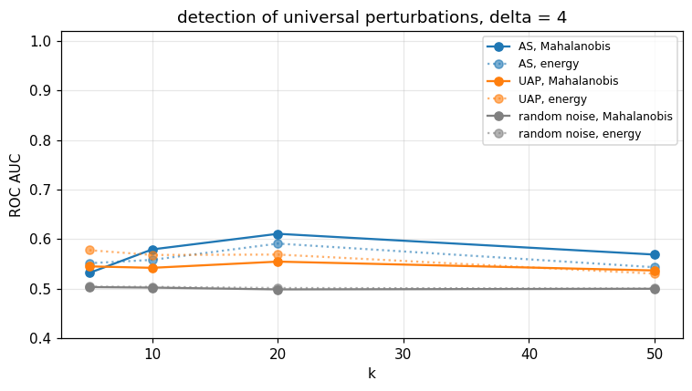

## Adversarial fine-tuning with the AS attack works

Starting from the trained VGG-19, fine-tune 5 epochs where half of every batch gets a universal perturbation
(‖v‖₂ = 4) that is **rebuilt with the AS attack on the current model every 60 steps** (from 100 training images).
Control: the same fine-tuning with random noise of the same norm. All three models are then attacked again from
scratch on 200 new training images (2 different sets), and the perturbations are applied to the test set.

| model | clean acc | AS transfer | UAP transfer | **AS adaptive** | **UAP adaptive** |
|---|---|---|---|---|---|
| base | 95.6% | 64.9% | 21.7% | 66.2 ± 0.1% | 33.4 ± 28.0% |
| noise fine-tuned | 95.7% | 61.7% | 19.9% | 66.0 ± 0.3% | 58.0 ± 9.0% |
| **AS fine-tuned** | 92.2% | **10.2%** | **3.9%** | **18.7 ± 0.1%** | **7.8 ± 4.0%** |

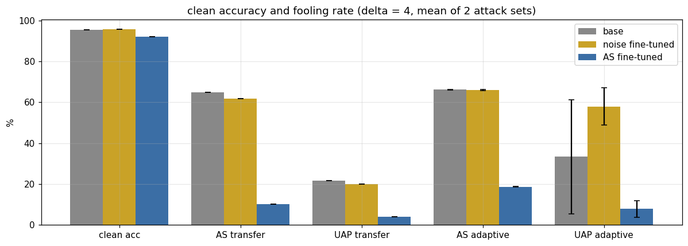

- Against an attack built on the fine-tuned model itself, the fooling rate of the AS attack drops from 66% to 19%,
  and of UAP from 33% to 8%: training only on AS perturbations also protects against the other attack.
- Fine-tuning on random noise of the same norm changes nothing, so the effect comes from the attack directions,
  not from noise augmentation.
- The cost is 3.4 points of clean accuracy (95.6% → 92.2%).

### Compared with other defenses

[`notebooks/defense_baselines.ipynb`](notebooks/defense_baselines.ipynb) <a href="https://colab.research.google.com/github/fatemehsalmani75/active-subspace-bloodmnist/blob/main/notebooks/defense_baselines.ipynb"></a>

Same base model (97.3%), 5 fine-tuning epochs each, half of every batch perturbed. Universal attacks at ‖v‖₂ = 4
rebuilt on each model (2 attack sets, mean ± std); per-image ℓ₂ PGD at ε = 2 (10 steps) on 1000 test images;
time on a Colab T4.

| defense | clean acc | AS fooling ↓ | UAP fooling ↓ | PGD-ℓ₂ acc ↑ | time |
|---|---|---|---|---|---|
| none | 97.3% | 46.5 ± 13.8% | 16.0 ± 9.6% | 29.1% | – |
| noise (control) | 97.1% | 46.3 ± 10.5% | 23.2 ± 15.5% | 29.8% | 1.8 min |
| **AS fine-tuning** | 93.9% | 17.2 ± 0.3% | 5.4 ± 1.8% | 35.2% | 4.8 min |
| UAP fine-tuning | 95.7% | 26.3 ± 2.8% | 7.7 ± 0.4% | 33.2% | 19.0 min |
| UAT (Shafahi et al.) | 93.2% | 17.1 ± 2.5% | 5.8 ± 0.2% | 38.2% | 1.8 min |
| PGD-AT (ε = 2) | 92.4% | **11.8 ± 0.3%** | **4.0 ± 2.0%** | **67.8%** | 4.6 min |

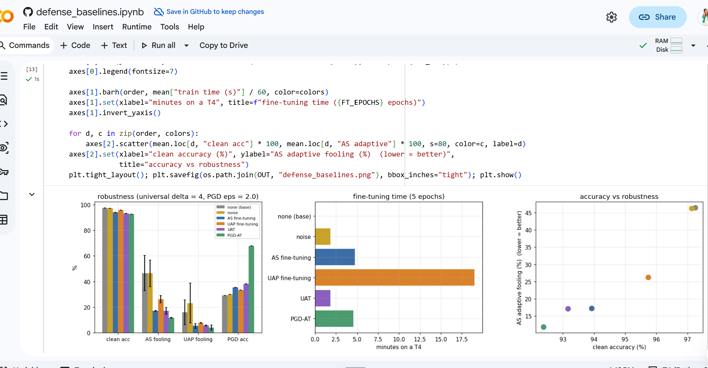

- AS perturbations are a much better training signal than DeepFool-based UAPs: lower fooling for both attacks
  and 4x less training time.
- But AS fine-tuning is **not better than Universal Adversarial Training**: the same robustness (17% vs 17%,
  5% vs 6%) with 0.7 points more clean accuracy, at 2.6x the training time.
- Per-image PGD adversarial training at ε = 2 is the strongest against universal attacks too, for 1.5 points of
  clean accuracy more than AS fine-tuning and the same training time.

So on BloodMNIST the active subspace is most useful as an **explanation** of universal vulnerability (C1–C3
above), not as a new defense. One run per defense; the UAT step size and the PGD budget were not tuned.

Limits of this result: one fine-tuning run, ‖v‖₂ = 4 only, and robustness to *universal* perturbations (not to
per-image attacks such as PGD). Natural next steps are the same experiment with several training seeds and norms,
a comparison with universal adversarial training based on UAP-style perturbations (Shafahi et al., AAAI 2020) and
with PGD adversarial training, and other MedMNIST datasets.

## Run it

The easiest way is the Colab notebook (button above). It trains the model, plots the eigenvalue spectrum,
builds ASNet and compares the two attacks.

Locally:

```bash
pip install -r requirements.txt

python scripts/train.py --model vgg19 --size 64 --epochs 30
python scripts/compress.py --ckpt checkpoints/vgg19_s64.pt --cut 16 --r 50 --p 2
python scripts/compress.py --ckpt checkpoints/vgg19_s64.pt --cut 16 --r 50 --l1 1e-4   # sparse ASNet-s
python scripts/attack.py --ckpt checkpoints/vgg19_s64.pt --delta 2 4 6 8 10 --n-train 200
python scripts/attack.py --ckpt checkpoints/vgg19_s64.pt --target-class 3 --n-train 100

pytest -q   # small tests on random data
```

BloodMNIST is downloaded automatically by the `medmnist` package.

## Code

```
asnet/
  data.py             BloodMNIST loaders
  models.py           VGG-19 and a small CNN, written so they can be cut after any layer
  active_subspace.py  gradient covariance, frequent-directions sketch, choice of r
  pce.py              Hermite polynomial chaos layer, least-squares fit
  asnet.py            ASNet, distillation fine-tuning, l1 proximal step
  attack.py           active-subspace universal attack
  defense.py          input-space active subspace, purification, detection
  robust.py           AS fine-tuning and the baselines (UAT, UAP fine-tuning, PGD-AT)
  analysis.py         checks for the attractor class
  uap_baseline.py     UAP baseline (through the Adversarial Robustness Toolbox)
scripts/              train / compress / attack from the command line
notebooks/            Colab notebook with all plots
tests/
```

Some details:

- 64x64 images are used because VGG-19 has five pooling layers and 28x28 images become too small.
- Defaults follow the paper where possible: p = 2, r = 50 (or chosen with eps = 0.05), distillation weight 0.1,
  Adam with learning rate 1e-4 for the first layers and 1e-5 for the new layers, alpha = 10 failed steps,
  200 images for the attacks and 10 iterations for UAP.
- Images are normalized to [-1, 1] and delta is the l2 norm of the perturbation in that space. The values in the
  paper were for CIFAR images, so a range of deltas is tried here.
- Fooling rate = fraction of images whose predicted label changes after adding the perturbation.
- The step-size search in the attack (signs ±1, steps delta, delta/2, ...) and the exact form of the
  distillation loss are my choices; the paper does not fix them completely.

## References and credits

All code in this repository was written for this project; nothing was copied from the authors' original
repositories (they have no license).

- C. Cui, K. Zhang, T. Daulbaev, J. Gusak, I. Oseledets, Z. Zhang. Active Subspace of Neural Networks: Structural
  Analysis and Universal Attacks. *SIAM J. Math. Data Sci.* 2(4):1096–1122, 2020.
  [doi:10.1137/19M1296070](https://doi.org/10.1137/19M1296070), [arXiv:1910.13025](https://arxiv.org/abs/1910.13025).
  Original code: https://github.com/chunfengc/ASNet
- P. G. Constantine. *Active Subspaces*. SIAM, 2015.
- E. Liberty (KDD 2013); M. Ghashami, E. Liberty, J. M. Phillips, D. P. Woodruff (SIAM J. Comput. 2016).
  Frequent directions.
- S.-M. Moosavi-Dezfooli, A. Fawzi, O. Fawzi, P. Frossard. Universal Adversarial Perturbations. CVPR 2017.
  Original code: https://github.com/LTS4/universal. The baseline here uses the implementation in
  [Adversarial Robustness Toolbox](https://github.com/Trusted-AI/adversarial-robustness-toolbox) (MIT).
- G. Hinton, O. Vinyals, J. Dean. Distilling the Knowledge in a Neural Network, 2015.
- A. Shafahi, M. Najibi, Z. Xu, J. Dickerson, L. S. Davis, T. Goldstein. Universal Adversarial Training. AAAI 2020.
  The fine-tuning loop here follows the same idea, with the AS attack generating the perturbation.
- **Data:** BloodMNIST from MedMNIST v2 (J. Yang et al., *Scientific Data* 10:41, 2023; ISBI 2021), CC BY 4.0,
  based on A. Acevedo et al., *Data in Brief* 30:105474, 2020. The images are not included in this repository.
  Not for clinical use.

The numbers in the thesis were obtained with an earlier version of the code. BibTeX entries are in
[`CITATION.bib`](CITATION.bib) and licenses of the dependencies in [`THIRD_PARTY_NOTICES.md`](THIRD_PARTY_NOTICES.md).

## License

MIT, see [LICENSE](LICENSE).
