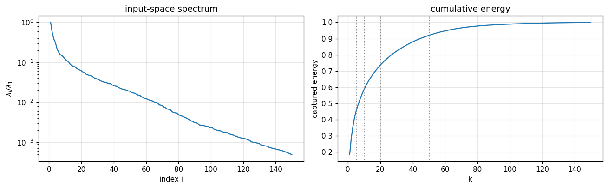
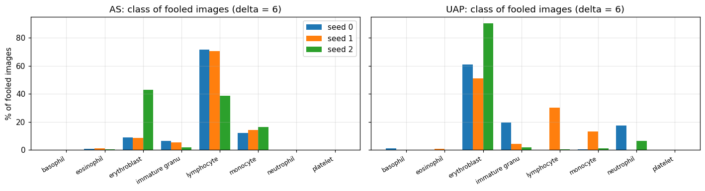
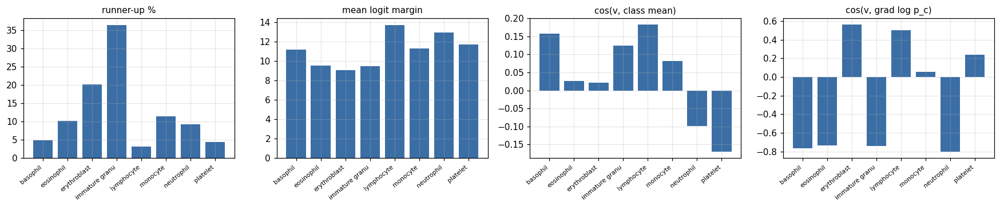
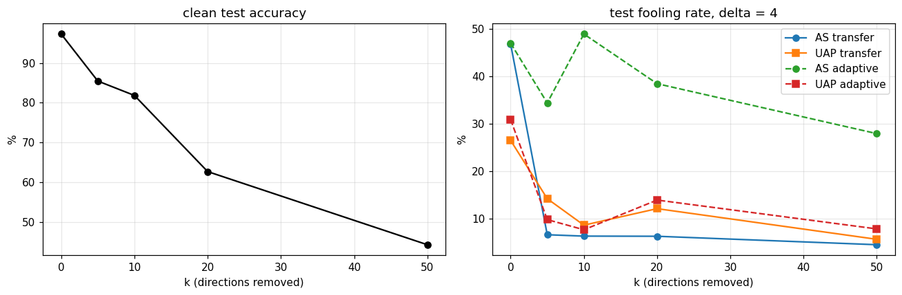
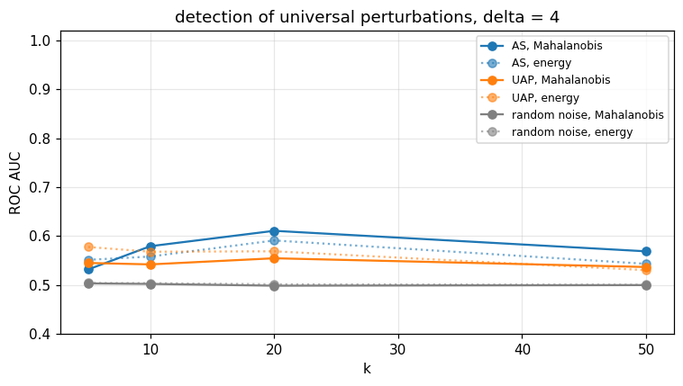
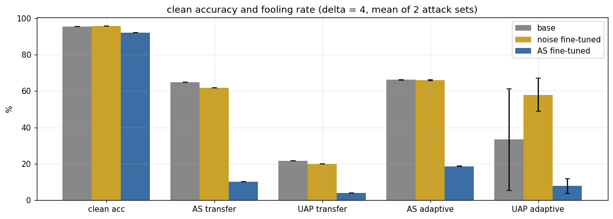
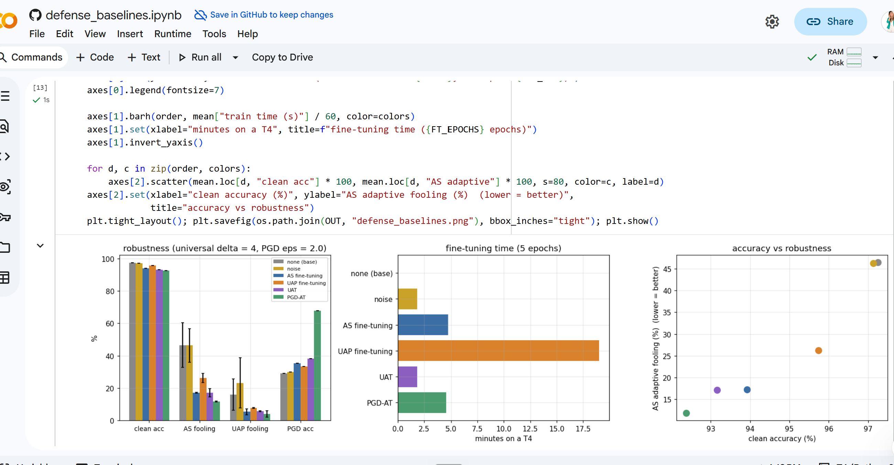

# Why the attack works, and can the same idea defend?

[← back to README](../README.md)

Notebooks:
[`defense_and_analysis.ipynb`](../notebooks/defense_and_analysis.ipynb) 
·
[`robust_training.ipynb`](../notebooks/robust_training.ipynb) 
·
[`defense_baselines.ipynb`](../notebooks/defense_baselines.ipynb) 

Contents

1. [The AS perturbation lives in a few input directions](#1-the-as-perturbation-lives-in-a-few-input-directions)
2. [Where do fooled images go?](#2-where-do-fooled-images-go)
3. [Purification does not survive an adaptive attack](#3-purification-does-not-survive-an-adaptive-attack)
4. [Detection is weak](#4-detection-is-weak)
5. [Adversarial fine-tuning with the AS attack works](#5-adversarial-fine-tuning-with-the-as-attack-works)
6. [Compared with other defenses](#6-compared-with-other-defenses)

Here the active subspace is computed in **input space**: the top-k eigenvectors $U_k$ of
$\mathbb{E}[\nabla_x \ell \, \nabla_x \ell^T]$ over 2000 clean training images.

## 1. The AS perturbation lives in a few input directions

Fraction of $\|v\|^2$ inside $\mathrm{span}(U_k)$ (‖v‖₂ = 4, mean ± std over 3 runs; the image has 12 288 dimensions):

| k | 5 | 10 | 20 | 50 |
|---|---|---|---|---|
| active subspace | **38.8 ± 9.0%** | **47.4 ± 10.2%** | **60.2 ± 12.3%** | **72.6 ± 5.0%** |
| UAP | 11.9 ± 2.6% | 22.9 ± 8.3% | 40.9 ± 13.5% | 53.3 ± 12.5% |

The AS attack concentrates its budget on the directions the model is most sensitive to, which explains why it is
stronger at the same norm.

## 2. Where do fooled images go?

- The attractor class is **not fixed**: the AS attack sends most fooled images to *lymphocyte* (about 70% in two runs,
  *erythroblast* in the third), UAP mostly to *erythroblast*.
- It is **not the nearest class**: lymphocyte is the runner-up class of only 3% of clean images and has the
  largest mean logit margin of all classes.
- The perturbation does **not look like** the average image of any class (|cos| < 0.2), but it is aligned with the
  model's gradient of $\log p_c$ for erythroblast (0.56) and lymphocyte (0.50), and opposite to the four granulocyte
  classes (about −0.75).

Erythroblasts and lymphocytes are the two cell types with a single round, dense nucleus filling most of the cell;
basophils, eosinophils, neutrophils and immature granulocytes have lobed or granular nuclei. The perturbation sits on
the nucleus and adds what *the model* treats as evidence of a round compact nucleus.

## 3. Purification does not survive an adaptive attack

Classify $x - U_kU_k^T(x-\mu)$ instead of $x$ (‖v‖₂ = 4):

Removing 5 directions makes the original AS perturbation useless (47% → 7%), but an attack re-run on the defended
model still fools 28–49% of the images, and clean accuracy drops from 97% to 85% (k = 5) and 63% (k = 20). The input
spectrum decays slowly (50 directions for 92% of the energy), so these directions also carry the class information.
Without the adaptive test this defense would have looked very good.

## 4. Detection is weak

ROC AUC of the score $\|U_k^T(x-\mu)\|^2$, clean vs. perturbed test images (‖v‖₂ = 4):

| k | 5 | 10 | 20 | 50 |
|---|---|---|---|---|
| active subspace | 0.659 | 0.620 | 0.579 | 0.553 |
| UAP | 0.552 | 0.550 | 0.551 | 0.548 |
| random noise (same norm) | 0.503 | 0.503 | 0.500 | 0.501 |

Better than chance and specific to the attack (random noise stays at 0.5), but far from usable: the natural variation
of clean images along these directions is much larger than the perturbation.

Dividing each direction by its clean variance (Mahalanobis score),
$s(x) = \sum_j (u_j^T(x-\mu))^2/\sigma_j^2$, does not help: ROC AUC 0.53–0.61 for the AS perturbation and 0.54–0.56
for UAP (random noise 0.50). A universal perturbation of norm 4 is a small shift compared with how much clean
blood-cell images vary, even direction by direction, so per-image detection along these directions is not a
practical defense.

## 5. Adversarial fine-tuning with the AS attack works

Starting from the trained VGG-19, fine-tune 5 epochs where half of every batch gets a universal perturbation
(‖v‖₂ = 4) that is **rebuilt with the AS attack on the current model every 60 steps** (from 100 training images).
Control: the same fine-tuning with random noise of the same norm. All three models are then attacked again from
scratch on 200 new training images (2 different sets), and the perturbations are applied to the test set.

| model | clean acc | AS transfer | UAP transfer | **AS adaptive** | **UAP adaptive** |
|---|---|---|---|---|---|
| base | 95.6% | 64.9% | 21.7% | 66.2 ± 0.1% | 33.4 ± 28.0% |
| noise fine-tuned | 95.7% | 61.7% | 19.9% | 66.0 ± 0.3% | 58.0 ± 9.0% |
| **AS fine-tuned** | 92.2% | **10.2%** | **3.9%** | **18.7 ± 0.1%** | **7.8 ± 4.0%** |

- Against an attack built on the fine-tuned model itself, the fooling rate of the AS attack drops from 66% to 19%,
  and of UAP from 33% to 8%: training only on AS perturbations also protects against the other attack.
- Fine-tuning on random noise of the same norm changes nothing, so the effect comes from the attack directions,
  not from noise augmentation.
- The cost is 3.4 points of clean accuracy (95.6% → 92.2%).

## 6. Compared with other defenses

Same base model (97.3%), 5 fine-tuning epochs each, half of every batch perturbed. Universal attacks at ‖v‖₂ = 4
rebuilt on each model (2 attack sets, mean ± std); per-image ℓ₂ PGD at ε = 2 (10 steps) on 1000 test images;
time on a Colab T4.

| defense | clean acc | AS fooling ↓ | UAP fooling ↓ | PGD-ℓ₂ acc ↑ | time |
|---|---|---|---|---|---|
| none | 97.3% | 46.5 ± 13.8% | 16.0 ± 9.6% | 29.1% | – |
| noise (control) | 97.1% | 46.3 ± 10.5% | 23.2 ± 15.5% | 29.8% | 1.8 min |
| **AS fine-tuning** | 93.9% | 17.2 ± 0.3% | 5.4 ± 1.8% | 35.2% | 4.8 min |
| UAP fine-tuning | 95.7% | 26.3 ± 2.8% | 7.7 ± 0.4% | 33.2% | 19.0 min |
| UAT (Shafahi et al.) | 93.2% | 17.1 ± 2.5% | 5.8 ± 0.2% | 38.2% | 1.8 min |
| PGD-AT (ε = 2) | 92.4% | **11.8 ± 0.3%** | **4.0 ± 2.0%** | **67.8%** | 4.6 min |

- AS perturbations are a much better training signal than DeepFool-based UAPs: lower fooling for both attacks
  and 4x less training time.
- But AS fine-tuning is **not better than Universal Adversarial Training**: the same robustness (17% vs 17%,
  5% vs 6%), with UAT 2.6x faster and AS fine-tuning 0.7 points higher in clean accuracy.
- Per-image PGD adversarial training at ε = 2 is the strongest against universal attacks too, for 1.5 points of
  clean accuracy less than AS fine-tuning and about the same training time.

So on BloodMNIST the active subspace is most useful as an **explanation** of universal vulnerability (sections 1–2),
not as a new defense.

**Limits.** One fine-tuning run per defense, ‖v‖₂ = 4 only, and the UAT step size and PGD budget were not tuned.
Natural next steps are several training seeds and norms, and other MedMNIST datasets.
