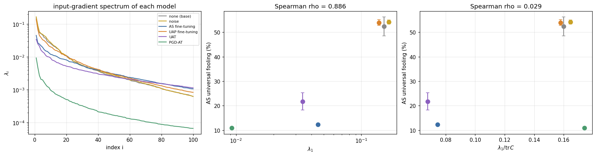
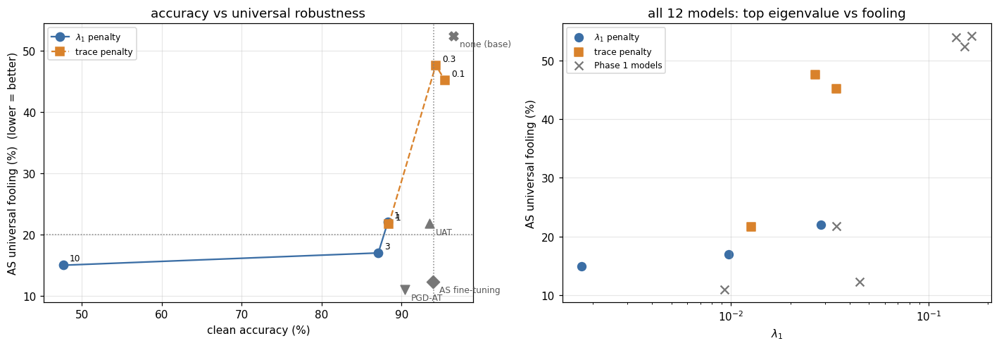

# Does the input-gradient spectrum predict universal vulnerability?

[← back to README](../README.md)

A two-phase test with the prediction and the decision rule written down before each run.

- **Phase 1** — across differently trained models, does the top eigenvalue $\lambda_1$ track universal fooling?
- **Phase 2** — if so, is it really $\lambda_1$, or just the overall gradient size tr C?

## Phase 1: does the top eigenvalue predict universal vulnerability?

[`phase1_spectrum_diagnostic.ipynb`](../notebooks/phase1_spectrum_diagnostic.ipynb) 

To first order a perturbation v changes the loss by $g^\top v$ with $g = \nabla_x \ell$, and
$\max_{\|v\|_2 \le \delta} \mathbb{E}[(g^\top v)^2] = \delta^2 \lambda_1(C)$, $C = \mathbb{E}[g g^\top]$, reached at $v = \delta u_1$.
Prediction, written before the run: across differently trained models, universal fooling rises with $\lambda_1$;
rule: Spearman $\rho \ge 0.8$ = supported.

Six models from the same base: undefended, the noise control and the four defenses of the
[defense comparison](defense.md#6-compared-with-other-defenses) (exact spectrum from 2000 training images; AS fooling at ‖v‖₂ = 4, 2 attack sets):

| model | clean acc | $\lambda_1$ | tr C | $\lambda_1$ / tr C | AS fooling | UAP fooling |
|---|---|---|---|---|---|---|
| base | 96.5% | 0.152 | 0.949 | 0.160 | 52.4 ± 3.9% | 25.4 ± 24.3% |
| noise | 96.4% | 0.165 | 1.006 | 0.164 | 54.1 ± 0.8% | 21.3 ± 11.3% |
| UAP fine-tuning | 95.9% | 0.138 | 0.873 | 0.158 | 53.9 ± 1.1% | 13.2 ± 14.9% |
| AS fine-tuning | 93.9% | 0.045 | 0.604 | 0.074 | 12.3 ± 0.1% | 6.2 ± 3.7% |
| UAT | 93.5% | 0.034 | 0.503 | 0.068 | 21.8 ± 3.6% | 3.5 ± 1.3% |
| PGD-AT | 90.4% | 0.009 | 0.053 | 0.174 | 11.0 ± 0.2% | 6.8 ± 2.8% |

- $\lambda_1$ vs AS fooling: Spearman $\rho = 0.886$ (p = 0.019), so by the rule fixed in advance the hypothesis is supported.
- But tr C gives exactly the same ranking ($\rho = 0.886$), and the share $\lambda_1$ / tr C predicts nothing
  ($\rho = 0.03$): with these six models one cannot tell the top eigenvalue from the overall gradient size.
- The correlation comes mostly from two groups (undefended about 53%, defended 11–22%); within the defended group
  the order is not exact (UAT has a smaller $\lambda_1$ than AS fine-tuning but is fooled more).

Data: [`results/phase1_spectrum.csv`](../results/phase1_spectrum.csv), [`results/phase1_correlations.csv`](../results/phase1_correlations.csv).

## Phase 2: penalize the top eigenvalue, or the whole trace?

[`phase2_spectral_regularization.ipynb`](../notebooks/phase2_spectral_regularization.ipynb) 

Fine-tuning from the same base with cross-entropy + $\beta R$, where $R$ is either the batch estimate of $\lambda_1(C)$
(power iteration) or of tr C (input-gradient regularization), three $\beta$ each. Rule fixed in advance: $\lambda_1$
matters if its models are less fooled than trace models at the same clean accuracy; the defense is useful if one
reaches AS fooling ≤ 20% at clean accuracy ≥ 94%.

| penalty | $\beta$ | clean acc | $\lambda_1$ | tr C | AS fooling | UAP fooling |
|---|---|---|---|---|---|---|
| $\lambda_1$ | 1 | 88.3% | 0.029 | 0.109 | 22.0 ± 1.0% | 11.8 ± 6.0% |
| $\lambda_1$ | 3 | 87.1% | 0.010 | 0.075 | 17.0 ± 0.8% | 4.9 ± 0.0% |
| $\lambda_1$ | 10 | 47.7% | 0.002 | 0.005 | 15.0 ± 2.2% | 5.0 ± 2.1% |
| trace | 0.1 | 95.4% | 0.034 | 0.259 | 45.2 ± 2.5% | 22.2 ± 20.0% |
| trace | 0.3 | 94.3% | 0.027 | 0.174 | 47.6 ± 0.7% | 29.7 ± 17.6% |
| trace | 1 | 88.4% | 0.013 | 0.066 | 21.7 ± 3.1% | 5.4 ± 1.6% |

**Result: both parts of the hypothesis are rejected.**

- At matched clean accuracy the two penalties give the same robustness ($\lambda_1$, $\beta = 1$: 88.3%, 22.0%;
  trace, $\beta = 1$: 88.4%, 21.7%), so the claim that $\lambda_1$ specifically matters is dropped. The $\lambda_1$
  penalty costs more accuracy ($\beta = 10$ collapses the model to 47.7%).
- No $\lambda_1$-penalty model reaches AS fooling ≤ 20% at ≥ 94% clean accuracy.
- With all 12 models (Phase 1 + 2) the Phase 1 correlation weakens: Spearman $\rho$ = 0.734 for $\lambda_1$ and
  0.727 for tr C vs AS fooling, below the 0.8 threshold. A clear counterexample: UAT and the trace penalty with
  $\beta = 0.1$ have the same $\lambda_1$ (0.034), the trace model even has the smaller tr C (0.26 vs 0.50), yet it is
  fooled twice as often (45% vs 22%).

So the first-order input-gradient spectrum at clean images does not determine universal vulnerability: adversarial
fine-tuning (UAT, AS) makes models robust in a way that shrinking the gradient spectrum does not reproduce.

Data: [`results/phase2_regularization.csv`](../results/phase2_regularization.csv).
