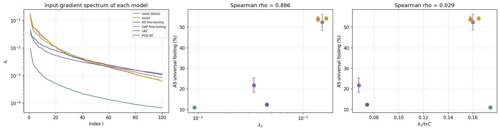
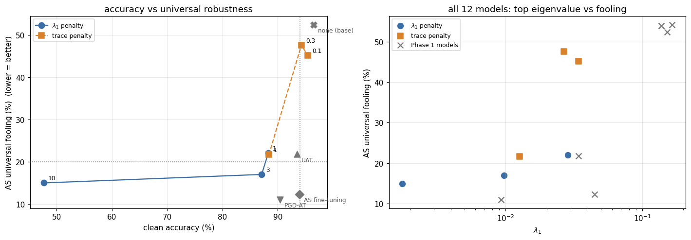
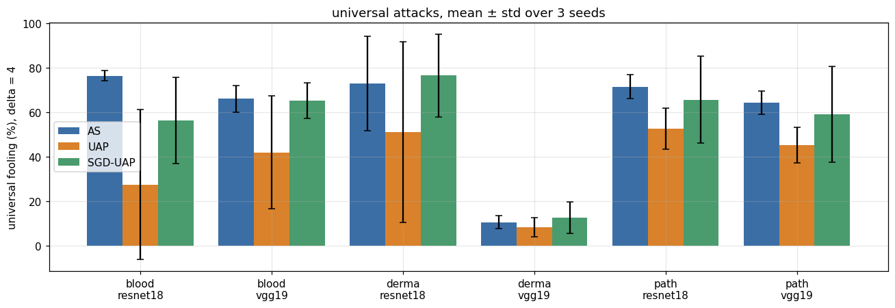
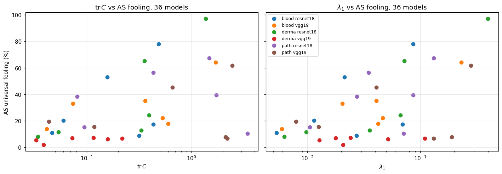
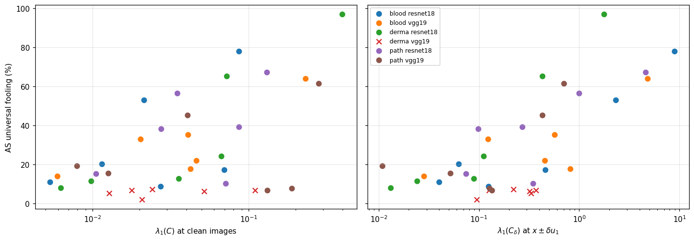
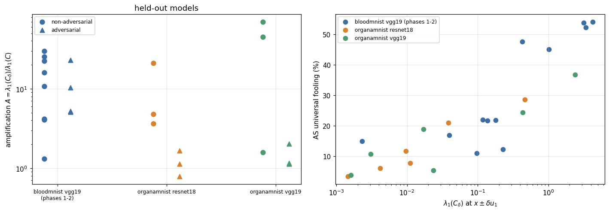

# Does the input-gradient spectrum predict universal vulnerability?

[← back to README](../README.md)

A two-phase test with the prediction and the decision rule written down before each run.

- **Phase 1** — across differently trained models, does the top eigenvalue $\lambda_1$ track universal fooling?
- **Phase 2** — if so, is it really $\lambda_1$, or just the overall gradient size tr C?

## Phase 1: does the top eigenvalue predict universal vulnerability?

[`phase1_spectrum_diagnostic.ipynb`](../notebooks/phase1_spectrum_diagnostic.ipynb) 

To first order a perturbation v changes the loss by $g^\top v$ with $g = \nabla_x \ell$, and
$\max_{\|v\|_2 \le \delta} \mathbb{E}[(g^\top v)^2] = \delta^2 \lambda_1(C)$, $C = \mathbb{E}[g g^\top]$, reached at $v = \delta u_1$.
Prediction, written before the run: across differently trained models, universal fooling rises with $\lambda_1$;
rule: Spearman $\rho \ge 0.8$ = supported.

Six models from the same base: undefended, the noise control and the four defenses of the
[defense comparison](defense.md#6-compared-with-other-defenses) (exact spectrum from 2000 training images; AS fooling at ‖v‖₂ = 4, 2 attack sets):

| model | clean acc | $\lambda_1$ | tr C | $\lambda_1$ / tr C | AS fooling | UAP fooling |
|---|---|---|---|---|---|---|
| base | 96.5% | 0.152 | 0.949 | 0.160 | 52.4 ± 3.9% | 25.4 ± 24.3% |
| noise | 96.4% | 0.165 | 1.006 | 0.164 | 54.1 ± 0.8% | 21.3 ± 11.3% |
| UAP fine-tuning | 95.9% | 0.138 | 0.873 | 0.158 | 53.9 ± 1.1% | 13.2 ± 14.9% |
| AS fine-tuning | 93.9% | 0.045 | 0.604 | 0.074 | 12.3 ± 0.1% | 6.2 ± 3.7% |
| UAT | 93.5% | 0.034 | 0.503 | 0.068 | 21.8 ± 3.6% | 3.5 ± 1.3% |
| PGD-AT | 90.4% | 0.009 | 0.053 | 0.174 | 11.0 ± 0.2% | 6.8 ± 2.8% |

- $\lambda_1$ vs AS fooling: Spearman $\rho = 0.886$ (p = 0.019), so by the rule fixed in advance the hypothesis is supported.
- But tr C gives exactly the same ranking ($\rho = 0.886$), and the share $\lambda_1$ / tr C predicts nothing
  ($\rho = 0.03$): with these six models one cannot tell the top eigenvalue from the overall gradient size.
- The correlation comes mostly from two groups (undefended about 53%, defended 11–22%); within the defended group
  the order is not exact (UAT has a smaller $\lambda_1$ than AS fine-tuning but is fooled more).

Data: [`results/phase1_spectrum.csv`](../results/phase1_spectrum.csv), [`results/phase1_correlations.csv`](../results/phase1_correlations.csv).

## Phase 2: penalize the top eigenvalue, or the whole trace?

[`phase2_spectral_regularization.ipynb`](../notebooks/phase2_spectral_regularization.ipynb) 

Fine-tuning from the same base with cross-entropy + $\beta R$, where $R$ is either the batch estimate of $\lambda_1(C)$
(power iteration) or of tr C (input-gradient regularization), three $\beta$ each. Rule fixed in advance: $\lambda_1$
matters if its models are less fooled than trace models at the same clean accuracy; the defense is useful if one
reaches AS fooling ≤ 20% at clean accuracy ≥ 94%.

| penalty | $\beta$ | clean acc | $\lambda_1$ | tr C | AS fooling | UAP fooling |
|---|---|---|---|---|---|---|
| $\lambda_1$ | 1 | 88.3% | 0.029 | 0.109 | 22.0 ± 1.0% | 11.8 ± 6.0% |
| $\lambda_1$ | 3 | 87.1% | 0.010 | 0.075 | 17.0 ± 0.8% | 4.9 ± 0.0% |
| $\lambda_1$ | 10 | 47.7% | 0.002 | 0.005 | 15.0 ± 2.2% | 5.0 ± 2.1% |
| trace | 0.1 | 95.4% | 0.034 | 0.259 | 45.2 ± 2.5% | 22.2 ± 20.0% |
| trace | 0.3 | 94.3% | 0.027 | 0.174 | 47.6 ± 0.7% | 29.7 ± 17.6% |
| trace | 1 | 88.4% | 0.013 | 0.066 | 21.7 ± 3.1% | 5.4 ± 1.6% |

**Result: both parts of the hypothesis are rejected.**

- At matched clean accuracy the two penalties give the same robustness ($\lambda_1$, $\beta = 1$: 88.3%, 22.0%;
  trace, $\beta = 1$: 88.4%, 21.7%), so the claim that $\lambda_1$ specifically matters is dropped. The $\lambda_1$
  penalty costs more accuracy ($\beta = 10$ collapses the model to 47.7%).
- No $\lambda_1$-penalty model reaches AS fooling ≤ 20% at ≥ 94% clean accuracy.
- With all 12 models (Phase 1 + 2) the Phase 1 correlation weakens: Spearman $\rho$ = 0.734 for $\lambda_1$ and
  0.727 for tr C vs AS fooling, below the 0.8 threshold. A clear counterexample: UAT and the trace penalty with
  $\beta = 0.1$ have the same $\lambda_1$ (0.034), the trace model even has the smaller tr C (0.26 vs 0.50), yet it is
  fooled twice as often (45% vs 22%).

So the first-order input-gradient spectrum at clean images does not determine universal vulnerability: adversarial
fine-tuning (UAT, AS) makes models robust in a way that shrinking the gradient spectrum does not reproduce.

Data: [`results/phase2_regularization.csv`](../results/phase2_regularization.csv).

## Phase 3: do the results hold on other datasets and architectures?

[`notebooks/phase3_multi_dataset.ipynb`](../notebooks/phase3_multi_dataset.ipynb) 

BloodMNIST, DermaMNIST and PathMNIST, each with VGG-19 and ResNet-18.

- **Part A**, 18 base models (3 seeds per setting): the AS attack against UAP (DeepFool) and SGD-UAP
  (Shafahi et al., 2020).
- **Part B**, 36 models (seed 0): the base model plus AS fine-tuning, UAT, PGD-AT and two trace-penalty models in
  each setting.

The rules were written before the run:

- **R1:** the AS attack is the stronger attack if it beats both baselines in at least 5 of 6 settings, with a
  paired Wilcoxon test p < 0.05.
- **R2:** tr C is a useful predictor if the median within-setting Spearman ρ is at least 0.7.
- **R3:** the trace penalty is a competitive cheap defense if, in at least 4 of 6 settings, it comes within
  5 points of UAT at a clean-accuracy cost of at most 2 points.

Decision ([`results/phase3_decision.txt`](../results/phase3_decision.txt)): **none of the three rules is met.**

**Part A, attack strength** (fooling at δ = 4, mean ± std over 3 seeds):

| setting | clean acc | balanced acc | AS | UAP | SGD-UAP |
|---|---|---|---|---|---|
| BloodMNIST, ResNet-18 | 98.2% | 98.2% | 76.4 ± 2.2% | 27.4 ± 33.7% | 56.2 ± 19.4% |
| BloodMNIST, VGG-19 | 96.4% | 96.3% | 66.0 ± 6.1% | 41.9 ± 25.4% | 65.3 ± 8.0% |
| DermaMNIST, ResNet-18 | 75.1% | 44.6% | 72.9 ± 21.3% | 51.0 ± 40.6% | 76.4 ± 18.7% |
| DermaMNIST, VGG-19 † | 70.2% | 27.3% | 10.4 ± 2.9% | 8.2 ± 4.4% | 12.5 ± 7.1% |
| PathMNIST, ResNet-18 | 84.9% | 81.2% | 71.4 ± 5.4% | 52.5 ± 9.2% | 65.6 ± 19.6% |
| PathMNIST, VGG-19 | 87.7% | 85.6% | 64.2 ± 5.2% | 45.2 ± 7.9% | 59.2 ± 21.5% |

† VGG-19 did not learn DermaMNIST (balanced accuracy 27%, close to always predicting the majority class), so
this row says little about attacks.

- **R1 not met.** The AS attack beats UAP in all 18 runs (Wilcoxon p < 0.0001), but not SGD-UAP (7 of 18 runs,
  p = 0.38).
- *Exploratory, not pre-registered:* the AS attack is much more stable across seeds. Its standard deviation,
  averaged over settings, is 7 points, against 20 for UAP and 16 for SGD-UAP.

**Part B, defenses** (AS fooling / clean accuracy, seed 0):

| setting | base | AS fine-tuning | UAT | PGD-AT | trace β=0.1 | trace β=1 |
|---|---|---|---|---|---|---|
| BloodMNIST, ResNet-18 | 78.1 / 98.2 | 17.3 / 97.0 | 8.9 / 96.6 | 11.1 / 95.0 | 53.0 / 97.9 | 20.3 / 90.1 |
| BloodMNIST, VGG-19 | 64.0 / 95.9 | 22.1 / 94.1 | 17.8 / 93.4 | 14.0 / 89.0 | 35.3 / 95.1 | 33.1 / 78.9 |
| DermaMNIST, ResNet-18 | 97.1 / 76.3 | 24.3 / 74.7 | 12.7 / 73.8 | 8.0 / 71.1 | 65.2 / 76.1 | 11.5 / 72.4 |
| PathMNIST, ResNet-18 | 67.4 / 83.5 | 39.4 / 84.0 | 10.4 / 77.4 | 15.3 / 83.5 | 56.5 / 86.1 | 38.4 / 76.8 |
| PathMNIST, VGG-19 | 61.6 / 86.1 | 7.9 / 86.2 | 6.8 / 85.3 | 15.5 / 81.8 | 45.3 / 81.8 | 19.4 / 51.6 |

- **R3 not met.** The trace penalty is close to UAT at low accuracy cost in only 1 of 6 settings. UAT and PGD-AT
  are the strongest defenses. AS fine-tuning cuts AS fooling sharply everywhere, but it stays behind UAT on
  ResNet-18.

**Gradient-size predictor**

- **R2 not met.** The median within-setting Spearman ρ is 0.43 for tr C and 0.46 for $\lambda_1$
  ([`results/phase3_correlations.csv`](../results/phase3_correlations.csv)).
- The models do not line up on one curve. At the same tr C, fooling ranges from under 10% to over 60%.

**Conclusion.** Across three datasets and two architectures:

- the AS attack is consistently stronger than DeepFool-based UAP and more stable than both baselines, but it is
  not stronger than SGD-UAP;
- neither the top eigenvalue nor the trace of the input-gradient covariance explains universal vulnerability;
- adversarial training with universal (UAT) or per-image (PGD) perturbations remains the reliable defense.

Data: [`results/phase3_attacks.csv`](../results/phase3_attacks.csv),
[`results/phase3_defenses.csv`](../results/phase3_defenses.csv).

## Phase 4: sensitivity on the δ-ball, not at the clean point

[`notebooks/phase4_shifted_spectrum.ipynb`](../notebooks/phase4_shifted_spectrum.ipynb) 

To second order, ℓ(x+v) − ℓ(x) ≈ gᵀv + ½ vᵀHv, and a clean-point spectrum sees only g.

**Hypothesis.** Universal vulnerability is set by $\lambda_1$ of the gradient covariance measured after moving
each image by ±δ along the clean top eigenvector $u_1$. No attack is run to compute it. The 36 Phase 3 models
are measured; nothing is retrained.

The rules were written before the run, and DermaMNIST/VGG-19 is excluded because the model did not learn:

- **H1:** the median within-setting Spearman ρ is at least 0.7.
- **H2:** this measure beats the clean-point $\lambda_1$ in at least 4 of 5 settings.

Decision ([`results/phase4_decision.txt`](../results/phase4_decision.txt)): **rejected by the pre-registered rule, narrowly.**

- **H1 not met.** The median within-setting ρ is 0.657, against a threshold of 0.7.
- **H2 met.** The shifted measure beats the clean-point $\lambda_1$ in 4 of 5 settings, with medians 0.66 vs 0.54.
- **H3.** The shifted measure orders UAT against trace β = 0.1 correctly in 4 of 5 settings.

**Exploratory observations (not pre-registered; to be confirmed on new models):**

- **Pooled over the 30 models,** Spearman ρ with AS fooling is 0.44 for the clean $\lambda_1$ and 0.68 for the
  shifted $\lambda_1$.
- **A random shift of the same norm changes nothing.** $\lambda_1$ stays within 0.6–1.2 times its clean value. The
  growth is specific to the active direction.
- **Amplification by model type.** The amplification $\lambda_1(C_\delta)/\lambda_1(C)$ is large for base models
  (median ×21) and for the weak gradient penalty, trace β = 0.1 (×14). It is small for the adversarially trained
  models: AS fine-tuning ×3.1, UAT ×4.6, PGD-AT ×4.7. This is the mechanism suggested in the hypothesis: a
  gradient penalty lowers the sensitivity at the clean point but not its growth along the active direction.

Data: [`results/phase4_spectra.csv`](../results/phase4_spectra.csv),
[`results/phase4_correlations.csv`](../results/phase4_correlations.csv).

## Phase 5: confirmatory test on models not seen before

[`notebooks/phase5_confirmatory.ipynb`](../notebooks/phase5_confirmatory.ipynb) 

The Phase 4 observations are tested on three held-out groups:

- OrganAMNIST with VGG-19 (new dataset, new models);
- OrganAMNIST with ResNet-18;
- the 12 BloodMNIST models of Phases 1–2.

The quantity tested is the amplification $A = \lambda_1(C_\delta)/\lambda_1(C)$.

The rules were written before the run:

- **C1:** adversarially trained models have a lower median $A$ than non-adversarial ones, in all 3 groups.
- **C2:** the shifted $\lambda_1$ reaches ρ ≥ 0.7 with AS fooling, and beats the clean $\lambda_1$, in at least
  2 of 3 groups.

Decision ([`results/phase5_decision.txt`](../results/phase5_decision.txt)): **confirmed.**

| held-out group | n | median A, adversarial | median A, non-adversarial | ρ shifted $\lambda_1$ | ρ clean $\lambda_1$ | median A, random shift |
|---|---|---|---|---|---|---|
| BloodMNIST VGG-19 (Phases 1–2) | 12 | 7.8 | 13.4 | **0.83** | 0.73 | 1.02 |
| OrganAMNIST ResNet-18 | 6 | 1.1 | 4.8 | **0.94** | 0.83 | 1.19 |
| OrganAMNIST VGG-19 | 6 | 1.2 | 44.9 | **0.83** | 0.71 | 0.99 |

- **C1 met (3/3).** In every group, adversarially trained models have lower amplification. Pooled one-sided
  Mann–Whitney over 24 models: p = 0.014.
- **C2 met (3/3).** The shifted $\lambda_1$ reaches ρ ≥ 0.7 and beats the clean $\lambda_1$ in every group.
- **Random-shift control.** A shift of the same norm in a random direction leaves $\lambda_1$ unchanged
  (median ×1.02).

Caveats:

- The groups are small (6, 6 and 12 models).
- Strong penalties without adversarial training also have a low A, but they pay for it in accuracy (for example,
  $\lambda_1$, β = 10: A = 1.3 at 48% clean accuracy).
- UAP fine-tuning did not make the model robust (54% fooled), and its A stayed high (×23). This fits the mechanism,
  but it means the "adversarial" label alone is a coarse grouping.

**Summary of Phases 1–5.** Clean-point spectral quantities ($\lambda_1$, tr C) do not explain universal
vulnerability. What matters is how much the input-gradient sensitivity grows when an image moves along the top
active direction. Gradient penalties lower the sensitivity at clean points but not this growth. Adversarial
training removes it, and the shifted $\lambda_1$ predicts universal fooling across datasets and architectures,
including on held-out models.

Data: [`results/phase5_models.csv`](../results/phase5_models.csv), [`results/phase5_groups.csv`](../results/phase5_groups.csv).
